# Guía de estudio — dso5200basic

Este documento divide el código fuente de `dso5200basic` en bloques temáticos
para estudiarlo de forma progresiva: de "cómo se abre el cable USB" hasta
"cómo aparece la señal en la pantalla". Cada bloque tiene:

- **Qué resuelve** (el problema, en una frase).
- **Conceptos** que hace falta entender antes de leer el código (a nivel
  teórico, no específico de este proyecto).
- **Librerías/APIs** que se usan.
- **Dónde está** (archivo + función), con una explicación de la implementación.
- **Preguntas para comprobar que lo entendiste**.

> Los diagramas de este documento están en sintaxis [Graphviz DOT](https://graphviz.org/doc/info/lang.html)
> (bloques ` ```dot `). Para compilar este archivo a PDF con pandoc, los
> diagramas se renderizan vía el filtro `pandoc-graphviz.lua` incluido en esta
> misma carpeta (requiere el paquete `graphviz` instalado, comando `dot`):
> ```sh
> pandoc GUIA_ESTUDIO.md --lua-filter=pandoc-graphviz.lua -o guia.pdf --pdf-engine=xelatex
> ```
> Sin el filtro, pandoc muestra el código DOT como texto plano en vez del
> diagrama.

## 0. Mapa general antes de entrar en detalle

El programa es un pipeline lineal: cada bloque le entrega datos al siguiente.

```dot
digraph mapa_general {
    rankdir=LR;
    node [shape=box, style="rounded,filled", fillcolor="#eef2ff", fontname="Helvetica", fontsize=11, margin="0.2,0.15"];
    edge [fontname="Helvetica"];

    A [label="1. Conexion USB\nusb/usbdevice.*\nusb/finddevice.*"];
    B [label="2. Carga de firmware\nusb/ezusb.*\nusb/uploadfirmware.*"];
    C [label="3. Protocolo\nprotocol/*"];
    D [label="4. Control del DSO\ndevice/dso5200.*"];
    E [label="5. Recepcion de datos\n(dentro de dso5200.cpp)"];
    F [label="6. Procesamiento\nconvertRawDataToSamples()"];
    G [label="7. Visualizacion\nstreaming/sample_server.*\nviewer/dso_viewer.py"];

    A -> B -> C -> D -> E -> F -> G;
}
```



`main.cpp` es el que arma esta cadena en tiempo de ejecución: busca el
dispositivo (bloque 1), le sube firmware si hace falta (bloque 2), crea un
`Dso5200Control` (bloques 3-6) y lo conecta a un `SampleServer` (bloque 7).
Conviene tener `main.cpp` abierto en una pestaña mientras se estudia cada
bloque, para ver dónde encaja cada pieza.

**Orden de lectura sugerido:** el orden de este documento (1→7) es también el
orden recomendado para leer el código por primera vez, porque cada bloque
usa conceptos y tipos definidos en el anterior.

---

## Bloque 1 — Conexión USB

**Qué resuelve:** encontrar el osciloscopio entre todos los dispositivos USB
conectados a la PC, y abrir un canal de comunicación con él (sin esto, nada
de lo demás es posible).

### Conceptos

- **Enumeración USB**: el sistema operativo mantiene una lista de todos los
  dispositivos USB conectados. Cada uno se identifica por un par
  **VID:PID** (Vendor ID : Product ID) — dos números de 16 bits que identifican
  fabricante y modelo. Un mismo dispositivo físico puede tener *distintos*
  VID:PID según su estado (por ejemplo, antes y después de cargarle firmware —
  ver Bloque 2).
- **Descriptores USB**: cada dispositivo expone una jerarquía de descriptores:
  *device* → *configuration* → *interface* → *endpoint*. Un **endpoint** es un
  canal de datos con dirección (IN = del dispositivo a la PC, OUT = de la PC
  al dispositivo) y un tipo de transferencia.
- **Tipos de transferencia USB** (los dos que usa este proyecto):
  - **Control transfer**: para comandos cortos, con semántica de
    petición/respuesta (como una llamada a función remota). Se usa para
    configurar el dispositivo o pedir datos pequeños.
  - **Bulk transfer**: para mover bloques de datos más grandes, sin garantía
    de latencia pero con corrección de errores a nivel de protocolo USB. Se
    usa para los comandos del osciloscopio y para traer las muestras
    capturadas.
- **Claim de interfaz**: antes de poder transferir datos, hay que "reclamar"
  (`claim`) la interfaz USB que se va a usar, para que el sistema operativo no
  se la entregue a otro proceso al mismo tiempo.

### Librería

- **[libusb-1.0](https://libusb.info/)**: librería en C, multiplataforma, para
  hablar con dispositivos USB desde espacio de usuario sin escribir un driver
  de kernel. Es la única dependencia externa del proyecto (aparte de la
  librería estándar de C++).

### Dónde está

| Archivo | Qué contiene |
|---|---|
| `src/usb/usbdevicedefinitions.h` | Constantes: endpoints (`HANTEK_EP_OUT=0x02`, `HANTEK_EP_IN=0x86`), timeouts, reintentos |
| `src/usb/usbdevice.h` / `.cpp` | Clase `USBDevice`: abre el dispositivo, reclama la interfaz, expone `bulkTransfer`/`controlTransfer` |
| `src/usb/finddevice.h` / `.cpp` | Función `Dso5200::findDevice()`: recorre todos los dispositivos USB buscando el DSO-5200/5200A |

**Enumeración** (`finddevice.cpp:13`, función `findDevice`): usa
`libusb_get_device_list()` para obtener la lista de dispositivos, y para cada
uno lee su `libusb_device_descriptor` (`libusb_get_device_descriptor`) y
compara `idVendor`/`idProduct` contra los VID:PID conocidos del DSO-5200
(constantes al inicio del archivo: `VID_FIRMWARE`, `VID_NO_FIRMWARE`,
`PID_5200`, `PID_5200A` — el product ID ya identifica la variante en ambos
estados, ver el caso real del Bloque 1 en "Para comprobar que lo entendiste").

Punto sutil de manejo de memoria: `libusb_free_device_list(deviceList, true)`
libera la lista y le quita una referencia a cada dispositivo. Por eso el
código hace `libusb_ref_device(found)` **antes** de liberar la lista — si no,
el puntero `found` quedaría apuntando a memoria ya liberada.

**Apertura y conexión** (`usbdevice.cpp`, clase `USBDevice`):
1. El constructor (`USBDevice::USBDevice`) sólo guarda el puntero al
   dispositivo y le suma una referencia (`libusb_ref_device`) — todavía no
   abre nada.
2. `connectDevice()` hace `libusb_open()` (obtiene un *handle*, el objeto que
   se usa para todas las operaciones posteriores), recorre los descriptores de
   configuración/interfaz buscando una interfaz "vendor specific" con 2
   endpoints, y llama a `claimInterface()`.
3. `claimInterface()` (línea ~78 de `usbdevice.h`, implementada en
   `usbdevice.cpp`) hace `libusb_claim_interface()` y guarda el tamaño máximo
   de paquete de cada endpoint (`wMaxPacketSize`) — dato que se usa más
   adelante en el Bloque 5 para trocear las lecturas grandes.

**Transferencias** (`usbdevice.cpp`, `bulkTransfer`/`controlTransfer`): son
wrappers delgados sobre `libusb_bulk_transfer()` y `libusb_control_transfer()`,
con reintentos automáticos en caso de timeout (`HANTEK_ATTEMPTS`) y detección
de desconexión (`LIBUSB_ERROR_NO_DEVICE` dispara `onDisconnected`, un
`std::function` — el equivalente sin Qt a una señal).

### Para comprobar que lo entendiste

- Confirmado contra hardware real: el product ID (`5200` vs `520a`) ya
  identifica la variante *antes* de cargar firmware — sólo el vendor ID
  cambia (`04b4`→`04b5`) al cargarlo (ver `finddevice.cpp`). ¿Por qué el
  fabricante habrá elegido cambiar el vendor ID y no el product ID al pasar
  de "sin firmware" a "con firmware"?
- ¿Qué pasaría si se intentara hacer un `bulkTransfer` sin haber llamado antes
  a `connectDevice()`? (mirá el primer `if` de `USBDevice::bulkTransfer`)
- ¿Por qué `controlTransfer` no necesita "reclamar" un endpoint como sí hace
  `bulkTransfer` con la interfaz completa?

---

## Bloque 2 — Carga de firmware

**Qué resuelve:** el DSO-5200 usa un microcontrolador Cypress **EZ-USB FX2**
que arranca "en blanco" (sin firmware propio grabado en una EEPROM externa
económica) — hay que subirle el programa a su RAM interna *cada vez* que se
enchufa, antes de que pueda hacer nada.

### Conceptos

- **Anchor download** (así se llama el patrón, viene de "Anchor Chips", la
  empresa original detrás del diseño EZ-USB): es la técnica estándar de
  Cypress para cargar firmware a la RAM de un microcontrolador FX2 vía USB,
  usando *control transfers* con un `bRequest` especial (`0xA0`, el
  "Cypress firmware download request").
- **Carga en dos etapas**: primero se sube un programa pequeño ("loader") que
  sabe recibir el firmware real por USB y escribirlo en RAM; luego se sube el
  firmware definitivo. Se hace así porque el USB del FX2 tarda un momento en
  reiniciarse tras cada carga, y separar loader/firmware permite verificar
  cada paso.
- **Formato Intel HEX**: los archivos `.hex` en `firmware/` no son binarios
  crudos — es un formato de texto ASCII línea por línea (`:LLAAAATT[DD...]CC`)
  donde cada línea trae una dirección de memoria, unos bytes de datos y un
  checksum. Es el formato estándar para "qué bytes van en qué dirección" al
  programar microcontroladores.
- **Reset del CPU vía registro `CPUCS`**: antes de escribir en RAM hay que
  poner el microcontrolador en reset (para que no ejecute código a medio
  escribir), y sacarlo de reset cuando termina la carga — se hace escribiendo
  un bit específico en la dirección `0xE600` (el registro `CPUCS` del FX2).

### Librería

Ninguna externa — `ezusb.cpp` es una implementación de referencia de Cypress/
fxload (una utilidad clásica de Linux), adaptada para llamar directamente a
`libusb`. No depende de Qt ni de nada del resto del proyecto salvo
`<libusb-1.0/libusb.h>`.

### Dónde está

| Archivo | Qué contiene |
|---|---|
| `src/usb/ezusb.h` / `.cpp` | Implementación del protocolo "anchor download" + parser de Intel HEX |
| `src/usb/uploadfirmware.h` / `.cpp` | Orquesta la subida de las dos etapas para el DSO-5200 en concreto |
| `firmware/*.hex` | Los 4 archivos de firmware (loader + firmware, para 5200 y 5200A) |

**Parser de Intel HEX** (`ezusb.cpp:218`, `parse_ihex`): lee el archivo línea
por línea, decodifica cada línea a `(dirección, bytes)` y llama a un callback
(`ram_poke`, línea 354) por cada bloque de datos.

**Escritura en RAM** (`ezusb.cpp:119`, `ezusb_write`): hace el control
transfer real — `libusb_control_transfer()` con `bRequest = RW_INTERNAL`
(`0xA0`) y `wValue` = la dirección de memoria destino. Cada línea del `.hex`
termina generando una o más de estas llamadas.

**Orquestación de las dos etapas** (`ezusb.cpp:546`, `ezusb_load_ram`,
llamada desde `uploadfirmware.cpp:16`, `UploadFirmware::startUpload`):
1. Abre el dispositivo (`libusb_open`) y reclama la interfaz 0.
2. `ezusb_load_ram(handle, loaderPath, FX_TYPE_FX2, /*stage=*/0)` — sube el
   loader.
3. `ezusb_load_ram(handle, firmwarePath, FX_TYPE_FX2, /*stage=*/1)` — sube el
   firmware real.
4. El dispositivo se reinicia solo y **vuelve a aparecer con otro VID:PID**
   (el "con firmware" del Bloque 1) — por eso `main.cpp` vuelve a llamar a
   `findDevice()` después de subir el firmware (ver `main.cpp`, función
   `openRealDevice`), en vez de asumir que el mismo objeto sigue siendo
   válido.

> Diferencia con el `UploadFirmware::startUpload` original de OpenHantek: la
> versión original extraía el `.hex` de un recurso Qt embebido a un archivo
> temporal (`QTemporaryFile`) porque `ezusb_load_ram()` necesita una *ruta de
> archivo*, no un buffer en memoria. Acá los `.hex` ya son archivos reales en
> `firmware/`, así que se les pasa la ruta directamente — una simplificación
> real al quitar Qt, no sólo un cambio cosmético.

### Para comprobar que lo entendiste

- ¿Por qué hace falta resetear el CPU del FX2 antes de escribir firmware y
  liberarlo después, en vez de escribir directamente?
- ¿Qué información puntual hace el parser de Intel HEX con cada línea del
  `.hex` (más allá de "son bytes")?
- Si `ezusb_load_ram` fallara a mitad de la segunda etapa (firmware), ¿en qué
  estado quedaría el dispositivo? (pista: leé qué hace `ezusb_load_ram` al
  final, más allá de mandar los datos)

---

## Bloque 3 — El protocolo de comunicación del DSO-5200

**Qué resuelve: cómo se "habla" con el osciloscopio una vez conectado** —
qué bytes hay que mandar para pedirle que cambie de escala, dispare, o
entregue muestras, y cómo interpretar lo que devuelve.

### Conceptos

- **Protocolo binario propietario**: a diferencia de protocolos de texto
  (HTTP, por ejemplo), acá cada comando es una secuencia fija de *bytes* en
  posiciones fijas — hay que conocer de antemano "el byte 2 es la ganancia,
  el byte 4 es la fuente de disparo", etc. Este conocimiento viene de
  ingeniería inversa del software original de Hantek (documentado en los
  comentarios de `bulkcode.h`/`controlcode.h`).
- **Comandos "bulk" vs comandos "control"**: el DSO-5200 usa las dos
  categorías del Bloque 1 para cosas distintas — los comandos de captura y
  ajuste de escala van por *bulk* (mandados con el patrón "código de
  operación al inicio del buffer"); los comandos de bajo nivel (offsets,
  relés analógicos, velocidad de conexión) van por *control transfer*.
- **`#pragma pack(1)` y bitfields**: varias estructuras (`ETsrBits`,
  `DBufferBits`, `GainBits`, etc., en `definitions.h`) empaquetan varios
  valores pequeños (2 bits, 3 bits...) dentro de un solo byte, usando
  *bitfields* de C (`uint8_t campo : 2;`). `#pragma pack(push, 1)` le dice al
  compilador que no agregue relleno (*padding*) entre campos — imprescindible
  porque estas estructuras se superponen literalmente sobre un buffer de
  bytes que después se manda por USB tal cual.
- **Jerarquía `BulkCommand`/`ControlCommand`**: cada comando concreto (por
  ejemplo `BulkSetGain`) hereda de una clase base que a su vez hereda de
  `std::vector<uint8_t>` — el objeto *es* el buffer de bytes que se manda,
  con métodos getter/setter que leen/escriben posiciones específicas de ese
  buffer. Es un patrón común en protocolos binarios: la estructura de datos
  en memoria es exactamente la representación en el cable.

### Librería

Ninguna — es C++ estándar (`<vector>`, bitfields, `#pragma pack`).

### Dónde está

| Archivo | Qué contiene |
|---|---|
| `types.h` | Alias básicos (`ChannelID`, `RecordLengthID`) |
| `definitions.h` | Los bitfields empaquetados (`ETsrBits`, `Tsr1Bits`, `GainBits`, etc.) y constantes (`HANTEK_TIMEOUT`, velocidades de conexión) |
| `states.h` | `CaptureState` (los estados que devuelve el osciloscopio: `CAPTURE_WAITING`, `CAPTURE_SAMPLING`, `CAPTURE_READY5200`...) |
| `bulkcode.h` | El enum `BulkCode` con cada opcode (`0x02`=FORCETRIGGER, `0x05`=GETDATA...) — **leé los comentarios de este archivo**, documentan byte a byte cada comando |
| `bulkcommand.h`/`.cpp` | Clase base `BulkCommand : public std::vector<uint8_t>` |
| `bulkStructs.h`/`.cpp` | Las clases concretas: `BulkSetSamplerate5200`, `BulkSetBuffer5200`, `BulkSetTrigger5200`, `BulkSetGain`, `BulkGetCaptureState`, etc. |
| `controlcode.h` | El enum `ControlCode` (comandos por *control transfer*: `0xb3`=BEGINCOMMAND, `0xb4`=SETOFFSET, `0xb5`=SETRELAYS...) |
| `controlcommand.h`/`.cpp` | Clase base `ControlCommand : public std::vector<uint8_t>` |
| `controlStructs.h`/`.cpp` | Las clases concretas: `ControlSetOffset`, `ControlSetRelays`, `ControlGetLimits`, `ControlBeginCommand` |
| `controlvalue.h` | Subcódigos usados dentro del comando genérico `CONTROL_VALUE` (`0xa2`) |

**Ejemplo concreto para seguir con el debugger o a mano** — `BulkSetGain`
(`bulkStructs.h:101`, implementación en `bulkStructs.cpp:244`):
```cpp
BulkSetGain::BulkSetGain() : BulkCommand(BulkCode::SETGAIN, 8) { this->init(); }
void BulkSetGain::setGain(ChannelID channel, uint8_t value) {
    GainBits *gainBits = (GainBits *)&(data()[2]);   // reinterpreta el byte 2 del buffer
    if (channel == 0) gainBits->channel1 = value;     // como una struct de 2 bitfields
    else gainBits->channel2 = value;
}
```
`data()` (heredado de `std::vector`) da el puntero al buffer crudo;
`(GainBits*)&(data()[2])` reinterpreta el byte en la posición 2 como la
struct `GainBits` de `definitions.h` (2 bits por canal). Escribir
`gainBits->channel1 = value` escribe directamente esos 2 bits dentro de ese
byte del buffer — no hay una "conversión", es la misma memoria vista de dos
formas distintas.

**Cómo se envía un comando bulk realmente** — todo comando bulk va precedido
por un `ControlBeginCommand` (`controlStructs.cpp:11`), que le avisa al
dispositivo "viene un comando bulk"; esto está encapsulado en
`Dso5200Control::bulkCommand()` (Bloque 4, `dso5200.cpp:432`) para no tener
que repetirlo en cada punto de uso.

### Para comprobar que lo entendiste

- ¿Por qué las clases de este bloque heredan de `std::vector<uint8_t>` en vez
  de simplemente *tener* un `std::vector<uint8_t>` como miembro?
- Elegí un comando de `bulkcode.h` (por ejemplo `BulkSetBuffer5200`, el
  comando `0x0d`) y compará la tabla de bytes en el comentario del `.h` con
  los métodos `set*`/`get*` de `bulkStructs.cpp` — ¿coincide cada campo con
  su posición documentada?
- ¿Qué garantiza que `#pragma pack(push, 1)` esté bien puesto en
  `definitions.h`? ¿Qué pasaría si faltara (con el compilador agregando
  padding)?

---

## Bloque 4 — Control del osciloscopio (la clase `Dso5200Control`)

**Qué resuelve:** traduce conceptos que entiende un humano ("2 ms de barrido",
"0.5 V/división", "canal 1 activo") a los comandos binarios del Bloque 3, y
mantiene el *estado actual* del osciloscopio (qué ganancia tiene puesta cada
canal, qué samplerate está corriendo, etc.) para poder hacer esos cálculos.

### Conceptos

- **Downsampling / divisor de muestreo**: el DSO-5200 muestrea internamente a
  una tasa fija muy alta (100/125 MS/s en modo normal, 200/250 MS/s en modo
  "fast rate") y luego *descarta* muestras según un divisor para lograr
  tasas más bajas. Pedir "1 ms de pantalla" implica calcular qué divisor da
  la tasa de muestreo más cercana que entra en el buffer disponible — eso es
  lo que hace `getBestSamplerate()`.
- **Modo "fast rate"**: cuando sólo se usa 1 canal, el osciloscopio puede
  usar los buffers de *ambos* canales para uno solo, duplicando la tasa de
  muestreo efectiva. Esto afecta tanto el cálculo de samplerate como el
  desempaquetado de datos (Bloque 6).
- **Escalones de ganancia (gain steps)**: el hardware no acepta cualquier
  V/división — sólo un conjunto fijo de escalones (0.16, 0.40, 0.80, 1.60,
  4.00, 8.00, 16.0, 40.0, 80.0 V/div). Pedir "0.5 V/div" implica buscar el
  escalón más cercano *hacia arriba* que lo cubra.
- **Calibración por canal (`offsetLimit`)**: el offset de cada canal no es un
  valor "libre" — el propio osciloscopio devuelve, por control transfer, los
  valores mínimo/máximo de offset válidos *para cada combinación de canal y
  ganancia* (`ControlGetLimits`/`retrieveChannelLevelData()`). Todo cálculo de
  offset/nivel de disparo pasa por esos límites.
- **Comandos "persistentes" vs "de una sola vez"**: algunos comandos (como
  `BulkSetTrigger5200`) empaquetan varios ajustes lógicos distintos (canal
  activo, pendiente de disparo, modo fast-rate) en el *mismo* byte de 8 bits.
  Por eso la clase guarda instancias persistentes de esos comandos como
  miembros (`triggerCommand`, `bufferCommand`, etc. en `dso5200.h`) en vez de
  construirlos de cero en cada llamada — así un `setChannelEnabled()` no
  pisa el bit de pendiente que ya se había puesto con `setTriggerSlope()`.

### Dónde está

| Archivo | Qué contiene |
|---|---|
| `device/idsosource.h` | Interfaz `IDsoSource` — el "contrato" que cumplen tanto `Dso5200Control` (hardware real) como `Simulator` (Bloque 7) |
| `device/dso5200.h` | Declaración de `Dso5200Control`: estado (`voltage[]`, `trigger`, comandos persistentes) y métodos |
| `device/dso5200.cpp` | La implementación completa — es el archivo más denso del proyecto, vale la pena leerlo función por función |

**Cálculo de samplerate** (`dso5200.cpp:188`, `getBestSamplerate`):
recibe la tasa deseada y calcula el divisor entero más cercano
(`base / divisor / samplerate`), redondeando hacia arriba o abajo según si se
pide "al menos esta tasa" o "como máximo esta tasa". El resultado se manda al
hardware en `updateSamplerate()` (línea 164), que separa el divisor en dos
valores de 8/16 bits (`samplerateFast`/`samplerateSlow`) porque así está
definido el comando `BulkSetSamplerate5200` (ver Bloque 3).

**Ajuste de ganancia** (`dso5200.cpp:289`, `doSetGain`): busca en la tabla
`kGain` (línea 34) el primer escalón que cubra el valor pedido, actualiza el
comando `gainCommand` y el comando `relaysCommand` (los relés analógicos que
conmutan atenuadores/rangos), y **encadena** una llamada a `doSetOffset()` —
porque el offset válido depende de qué ganancia está puesta.

**Nivel de disparo** (`dso5200.cpp:340`, `doSetTriggerLevel`, expuesto por el
comando CLI `trigger <volts>` vía `setTriggerLevel()` en la línea 110): la
lógica es simétrica a la de offset — el nivel en volts se convierte a un
valor crudo del rango de calibración del canal (mismos `offsetLimit` que usa
`doSetOffset()`) y se manda por `ControlSetOffset::setTrigger()`. Sólo tiene
efecto si el canal coincide con `trigger.source` (fijo en CH1 en esta
herramienta — ver el segundo caso real, más abajo, sobre qué pasó cuando eso
no estaba bien configurado).

**Máquina de estados de captura** (`dso5200.cpp:554`, `threadMain`): un hilo
dedicado (ver el Anexo de hilos, más abajo) que pregunta periódicamente al
osciloscopio en qué estado está (`CAPTURE_WAITING`, `CAPTURE_SAMPLING`,
`CAPTURE_READY5200`) y decide qué hacer en cada uno — esto conecta
directamente con el Bloque 5.

> **Caso real encontrado probando contra hardware**: el código original de
> OpenHantek sólo reintenta armar el disparo (`BulkTriggerEnabled`) o forzarlo
> (`BulkForceTrigger`) mientras `captureState == CAPTURE_WAITING`. Contra un
> DSO-5200A real, sin señal conectada en el canal de disparo, el osciloscopio
> pasó a `CAPTURE_SAMPLING` y **se quedó ahí para siempre** — como el código
> nunca reintenta desde ese estado, la captura quedaba colgada
> indefinidamente. Se corrigió compartiendo la misma lógica de
> armado/forzado/reinicio entre `CAPTURE_WAITING` y `CAPTURE_SAMPLING` (ver el
> comentario en el código, justo antes de `case CAPTURE_WAITING:`). Es un buen
> ejemplo de por qué "portar la lógica tal cual" no siempre alcanza: el
> supuesto implícito de upstream (que el hardware vuelve a `CAPTURE_WAITING`
> periódicamente si no hay disparo) resultó no cumplirse siempre en la
> práctica.

> **Segundo caso real: fuente de disparo mal configurada por omisión**. Este
> port nunca llamaba al equivalente de `HantekDsoControl::setTriggerSource()`
> — dejaba el campo `ETsrBits.triggerSource` en su valor por defecto (0). En
> el protocolo del DSO-5200 ese campo usa un mapeo invertido
> (`1 - hardwareID`, ver el código original), así que el valor 0 en realidad
> le dice al hardware "el disparo es sobre CH2", no CH1. Con una señal real
> conectada sólo a CH1, el comparador de disparo nunca veía un flanco que
> calificara — el osciloscopio caía siempre en disparo forzado, produciendo
> una imagen inestable, con casi todas las capturas mostrando la señal
> "plana" (dentro de un mismo semiciclo) en vez de un flanco real. Se detectó
> comparando estadísticas de muchas capturas (¿cuántas mostraban una
> transición real vs. una señal plana?) contra el valor esperado, y se
> confirmó agregando trazas de `--debug` a `doSetTriggerLevel()`. Es un buen
> ejemplo de por qué "no llamar a una función" puede ser un bug tan real como
> llamarla mal: la función `setTriggerSource()` de upstream nunca se portó
> a esta herramienta porque la fuente de disparo se asumió "fija en CH1" y
> se dio por hecho que el valor por defecto del protocolo ya reflejaba eso.

> **Tercer caso real: `timebase` no cambiaba nada, de verdad**. Con el
> osciloscopio ya disparando de forma estable (casos anteriores resueltos),
> cambiar `timebase` seguía sin tener ningún efecto visible: a 100 us, 10 ms o
> 40 ms se veía siempre la misma ventana corta de señal. Se confirmó
> empíricamente que no era percepción — capturando datos crudos a 100 us y a
> 40 ms daban prácticamente la misma señal, byte a byte. La causa: la fórmula
> de `updateSamplerate()` (heredada de `getBestSamplerate()`, portada de
> OpenHantek) calcula el divisor `SamplerateSlow`/`SamplerateFast` de forma
> *continua* (`0xffff - valueSlow`), pero el DSO-5200 sólo entiende un
> conjunto **fijo** de 12 valores "mágicos" de 16 bits para `SamplerateSlow`
> — cualquier otro valor simplemente no cambia la tasa real de muestreo. Se
> confirmó cruzando esos valores contra dos implementaciones independientes,
> ambas con soporte probado del DSO-5200A: el driver `hantek-dso` de sigrok y
> [`Blokkendoos/HantekDSO`](https://github.com/Blokkendoos/HantekDSO) (ambas
> reportan **exactamente los mismos 12 valores**, byte a byte). La solución
> (`kSlowTimebaseTable` y `doSetRecordTime()`/`applyTimebaseTableEntry()` en
> `dso5200.cpp`) reemplaza la fórmula continua por una búsqueda en esa tabla
> fija, calculando la duración real de cada entrada con la fórmula
> documentada del comando `0x0c` y eligiendo la más cercana a lo pedido.
> Importante: en el camino se probó — y se descartó — una hipótesis
> relacionada: que el comando combinado `SETTRIGGERANDSAMPLERATE` (`0x01`,
> el que usa sigrok "de forma uniforme" y el que usa `HantekDSO` en su
> `dsoSetTriggerAndSampleRate()`) fuera el correcto para el DSO-5200. Pero la
> propia documentación de protocolo de OpenHantek (`bulkcode.h`) aclara que
> ese comando combinado sólo es válido para `MODEL_DSO2090`/`MODEL_DSO2150`
> — el DSO-5200/5200A usan el par de comandos *separados*
> `CSETTRIGGERORSAMPLERATE` (`0x0c`, sólo samplerate) +
> `ESETTRIGGERORSAMPLERATE` (`0x0e`, sólo bits de disparo), que es
> justamente lo que este port ya enviaba. El problema nunca fue el comando
> (el "framing"), sino los *valores* que se metían en él.

> **Cuarto caso real: el relé de atenuación cambiaba un escalón demasiado
> pronto**. Con `timebase` ya arreglado, quedó otro síntoma: pedir ciertos
> V/división concretos (1.6 V, 16 V — los valores a los que redondean
> pedidos "razonables" como "1 V" o "10 V") dejaba el canal leyendo **cero
> plano**, de forma permanente (se confirmó que no era un problema de tiempo
> de asentamiento capturando durante 6+ segundos seguidos sin que se
> recuperara solo), en CH1 y CH2 por igual, y se resolvía en cuanto se pedía
> *cualquier otro* V/división. La pista definitiva no salió de este
> proyecto, sino de revisar el historial de git de otro fork de OpenHantek
> (`OpenHantek6022`, que en su día también dio soporte al DSO-5200): el
> commit `b935f4e` ("Mostly DSO-5200 bugfixes, thanks to Ash", 2010) agrega
> justo el comentario que ya estaba — sin explicación — en nuestro propio
> `controlcode.h`: *"The limits are `<=` instead of `<` for the 10 bit
> models, since those support voltages up to 10 V"*. El DSO-5200/5200A son
> justamente eso, un modelo de 10 bits — y en algún punto entre ese fix de
> 2010 y la versión de `modelDSO5200.cpp` de la que salió este port, esa
> rama específica del modelo se perdió, dejando sólo la fórmula genérica (de
> 8 bits) `gainID < 3` / `gainID < 6`, que cambia el relé un escalón antes de
> lo debido — justo en los índices 3 y 6, justo donde se veía el cero plano.
> El mismo commit reveló, además, que la tabla de índice de ganancia
> (`kGain[].index`, lo que se manda por `BulkSetGain`) y la tabla de
> divisores de decodificación (`kVoltageLimit[]`) también habían derivado
> hacia la fórmula genérica en vez de la específica del DSO-5200
> (`gainId % 3` con una excepción en `gainId == 0`). Corrigiendo las tres
> tablas a la vez (ver los comentarios junto a `kGain`/`kVoltageLimit` y
> `doSetGain()` en `dso5200.cpp`), los 9 escalones de ganancia dan lecturas
> reales — se verificó capturando en los tres escenarios que reprodujeron el
> síntoma original (cambio en pleno muestreo en CH1, en CH2, y configurado
> antes de arrancar). Moraleja: cuando un comentario en el propio código dice
> "esto es distinto para tal modelo" sin dar más contexto, vale la pena
> tomárselo en serio — y el historial de git de proyectos hermanos puede
> tener el fix exacto que el refactor posterior perdió sin querer.

> **Quinto caso real: dos bugs de unidades en la posición de pre-disparo, y
> el registro `fast` de la tabla de timebase estaba mal para 11 de 12
> entradas**. Con `timebase` y los escalones de ganancia ya arreglados,
> seguía apareciendo un síntoma grave: capturando una señal cuadrada
> conocida (generador externo *y* la salida CAL interna del propio equipo,
> para descartar el generador como variable) el buffer mostraba **un único
> flanco aislado, seguido de una meseta plana** hasta el final de la
> ventana — nunca los varios ciclos que debía haber, y esto se confirmó
> **idéntico en las 12 entradas de `kSlowTimebaseTable`** (246 us a 1.64 s):
> la forma no cambiaba con la ventana pedida, sólo la etiqueta de tiempo del
> eje X.
>
> **Primer bug (unidades, x2)**: `doSetPretriggerPosition()` calculaba
> `positionSamples = position * samplerateCurrent`, tratando `position` como
> si ya fuera un desplazamiento en segundos — pero `trigger.position` en
> este port está declarado y usado como una fracción `0..1` de pantalla,
> nunca convertida. El mismo error exacto estaba también en el cálculo de
> `startCycle` (`trigger.position * 1000.0 / cycleTimeMs`) dentro de
> `threadMain()`. El propio OpenHantek hace la conversión fracción→segundos
> en la capa de arriba (la GUI, `main.cpp`: `position * horizontal.timebase
> * DIVS_TIME`) antes de llamar a las funciones equivalentes — conversión
> que este port nunca portó, en ninguno de los dos sitios. Con
> `position = 0.0` (el valor por omisión) el primer error queda enmascarado
> (`0.0 * cualquier_cosa = 0`), pero ya producía `TriggerPositionPre =
> 0xD7FF`, `TriggerPositionPost = 0xFFFF` (este último fuera del rango
> documentado en `bulkcode.h`, un desborde de 1) en vez del `0xEBFF/0xEBFF`
> real (disparo centrado al 50%, confirmado byte a byte contra una captura
> USB del software oficial de Windows). El segundo error (`startCycle`) era
> peor en la práctica: para timebases rápidos daba un `startCycle` enorme
> (51 ciclos de sondeo — más de medio segundo real — antes de siquiera
> armar el disparo, para una ventana reclamada de sólo 8 ms). Arreglar
> ambos (multiplicar por `recordLength`, o por el largo de ventana en ms
> según corresponda, en vez de tratar la fracción como segundos) mejoró la
> captura de ~99.9%/0.1% (casi todo en un solo nivel) a ~50/50 — una mejora
> real, pero **no resolvió el síntoma completo**: seguía siendo un único
> flanco, no varios ciclos.
>
> **La pista definitiva** salió de medir tiempo real de reloj en vez de
> confiar en lo que el software reporta de sí mismo: pidiendo la ventana más
> lenta (1.638 s) y midiendo desde `start` hasta el primer dato (con el
> timestamp que ya trae cada frame), el dato llegó en 0.435 s — menos de un
> tercio de lo físicamente posible. Repitiendo la misma medición sobre la
> captura USB real del software de Windows, en un ajuste equivalente (~0.33s
> reclamados): su tiempo real promedio fue 0.309 s, casi idéntico. El
> software real sí respeta el tiempo físico; el nuestro no — así que el
> problema tenía que estar en los *valores* que hacen que el dispositivo
> realmente muestree despacio, no en el estado de disparo.
>
> **El bug real**: replicando a mano, byte a byte y con los mismos tiempos
> de espera, la secuencia USB completa de una captura lenta de Windows
> (usando `pyusb` directo, sin pasar por este proyecto en absoluto) sí
> produjo una onda periódica real — 412 ciclos limpios donde nuestro propio
> software daba uno solo. La diferencia: Windows usaba
> `SamplerateSlow=0xF825, SamplerateFast=0x02` para ese ajuste; la entrada
> equivalente de nuestra tabla era `SamplerateSlow=0xFFCE, SamplerateFast=
> 0x04`. **Ambos pares dan exactamente el mismo divisor** por la fórmula
> documentada (`divider = 2·(0x10000−slow) + 4−fast`) — 100, en ese caso —
> así que parecían intercambiables, y por eso se habían dado por buenos
> (cruzados contra sigrok y HantekDSO, que también usan `fast=4`: el bug no
> es de esos proyectos, es que ninguno de los dos parece haber probado el
> DSO-5200 real a fondo en timebases lentos). **El hardware real no es
> indiferente a qué par le mandás aunque el divisor matemático sea idéntico**.
> Sustituyendo la entrada de la tabla por el par exacto de Windows, a través
> de todo el pipeline C++ normal (con nuestra propia configuración de
> ganancia/relés/offset, sin tocar nada más), la captura pasó a mostrar 413
> ciclos reales. La regla general resultó ser simple: `fast=2` en vez de
> `fast=4`, con `slow` un valor más alto (`slow_correcto = slow_viejo + 1`,
> consecuencia directa de la fórmula del divisor). Se corrigieron las 12
> entradas de la tabla con esa regla y se verificaron las 12 contra el
> generador real: el número de ciclos capturados ahora escala
> proporcionalmente con la ventana pedida (1, 2, 2, 2, 6, 12, 35, 74, 106,
> 304, 1002/1024 ciclos de 246 us a 819 ms) — exactamente lo esperado para
> una señal de 1 kHz.
>
> Moraleja: un valor por omisión de `0.0` puede esconder un bug de unidades
> durante meses porque `0 * cualquier_unidad = 0` — probalo con un valor
> distinto de cero apenas sospeches algo así. Cuando algo "debería tardar X"
> y no cuadra, medí el tiempo de reloj real en vez de confiar en lo que el
> propio software reporta de sí mismo. Y cuando dos configuraciones dan el
> mismo resultado en una fórmula documentada, no asumas que el hardware las
> trata igual — replicá la de la referencia que sabés que funciona, byte a
> byte, antes de confiar en tu propia derivación "equivalente".

### Para comprobar que lo entendiste

- Si pedís `volts 1 0.5` (0.5 V/div) por CLI, ¿qué escalón real termina
  usando el hardware, y por qué (mirá `kGain` en `dso5200.cpp:82`)?
- ¿Por qué `doSetChannelUsed()` puede terminar llamando a
  `doSetRecordTime()` (mirá el final de la función)? ¿Qué relación hay entre
  "cuántos canales están activos" y "qué samplerate máximo se puede pedir"?
- `triggerCommand` es un solo objeto miembro que numerosas funciones
  modifican parcialmente. ¿Qué pasaría si en vez de eso cada función creara
  su propio `BulkSetTrigger5200` local?

---

## Bloque 5 — Recepción de datos

**Qué resuelve:** una vez que el osciloscopio terminó de capturar, hay que
traer las muestras crudas a la PC — que pueden ser más grandes que el
paquete USB máximo, así que hay que trocear la lectura.

### Conceptos

- **Polling de estado**: no hay una interrupción/callback que avise "ya
  terminé de capturar" — hay que preguntar repetidamente (`GETCAPTURESTATE`)
  hasta ver el estado `CAPTURE_READY5200`.
- **Tamaño máximo de paquete (`wMaxPacketSize`)**: USB Full-Speed transfiere
  paquetes de 64 bytes, High-Speed de 512 bytes (ver `getConnectionSpeed`/
  `getPacketSize` del proyecto original — en esta versión no se exponen
  porque no se soporta el modo *roll* que los necesitaba, pero el concepto
  sigue aplicando dentro de `bulkReadMulti`). Pedir de una vez un bloque de
  datos más grande que ese tamaño requiere partirlo en varias transferencias
  bulk sucesivas.
- **Punto de disparo (trigger point)**: el osciloscopio no devuelve
  directamente "el flanco disparó en la muestra 1234 de la pantalla" — mezclado
  con `GETCAPTURESTATE` devuelve un valor que indica dónde, dentro del buffer
  circular interno del hardware, ocurrió el disparo. Ese valor hay que usarlo
  para "rotar" la lectura del buffer de forma que la muestra del disparo quede
  al principio de lo que se manda al visor (si no, la señal se ve temblando de
  un lado a otro en cada captura, en vez de quedarse fija).

### Dónde está

**Estado de captura** (`dso5200.cpp:438`, `getCaptureState`): manda
`BulkGetCaptureState` (comando `0x06`) y lee la respuesta con
`device->bulkRead(&response)` — nótese que acá `bulkRead` (definido en
`usbdevice.h:49`) usa el mismo buffer del objeto `response` tanto para pedir
como para recibir, un patrón típico en protocolos de bulk transfer simples.

**Uso del punto de disparo** (`dso5200.cpp:564`, dentro de `threadMain`, justo
después de `getCaptureState()`): `trigger.point = triggerPoint;` — se usa
**tal cual**, sin decodificación adicional. No siempre fue así: ver el caso
real más abajo, sobre por qué se sacó una decodificación de bits que
OpenHantek sí aplica.

**Lectura troceada** (`dso5200.cpp:449`, `getSamples`, que llama a
`device->bulkReadMulti()` en `usbdevice.cpp`): pide `GETDATA` (`0x05`),
calcula cuántos bytes totales espera (`getSampleCount()` — que depende de si
está en modo fast-rate, Bloque 4) y delega el troceo real en
`USBDevice::bulkReadMulti`, que hace un *loop* de `bulkTransfer()`s de a
`inPacketLength` bytes hasta completar el total pedido.

> **Sexto caso real: una decodificación "canónica" que resultó estar de
> más**. OpenHantek decodifica el valor crudo de `triggerPoint` con un truco
> de bits antes de usarlo (`calculateTriggerPoint`, "cada bit puesto invierte
> todos los bits de menor valor") — y este port lo copió tal cual al
> principio, fiel al original. El resultado: el disparo real enganchaba
> (Bloque 4), pero la señal seguía "temblando" — el flanco aparecía en una
> muestra distinta en cada captura, disperso por toda la ventana. Para
> investigarlo se comparó contra una implementación independiente de otro
> proyecto que también soporta esta familia de Hantek
> ([driver `hantek-dso` de sigrok](https://github.com/sigrokproject/libsigrok/blob/master/src/hardware/hantek-dso/protocol.c)):
> **el mismo truco de bits aparece ahí también**, con un comentario del propio
> autor de sigrok admitiendo *"No idea why the device reports the trigger
> point this way"* — es decir, ni el equipo de OpenHantek ni el de sigrok
> tenían una explicación real de por qué hace falta esa decodificación,
> sólo la copiaron de la ingeniería inversa original contra el DSO-2090/2150.
> Probando empíricamente contra el DSO-5200A (capturando 25+ frames, midiendo
> en qué muestra exacta aparecía un flanco real conocido en cada uno, primero
> con la decodificación y después sin ella) se confirmó: **sin decodificar,
> el flanco queda fijo en la misma muestra siempre** (desviación estándar 0
> en la posición del flanco, contra ~3100 muestras de dispersión con la
> decodificación puesta). La decodificación de bits simplemente no aplica al
> DSO-5200(A) — se eliminó del código. Moraleja: que un algoritmo esté en el
> proyecto original (¡e incluso replicado en un segundo proyecto
> independiente!) no lo vuelve automáticamente correcto para *tu* modelo
> específico de hardware — cuando algo se explica con "no sabemos muy bien
> por qué, pero funciona", conviene medirlo con el dispositivo real antes de
> confiar en portarlo sin cuestionarlo.

### Para comprobar que lo entendiste

- ¿Por qué `getSamples()` multiplica `totalSampleCount` por 2 al calcular
  `dataLength`? (pista: el Bloque 6 explica qué es cada mitad del buffer)
- Si `bulkReadMulti` recibe menos bytes de los pedidos en algún paquete
  intermedio, ¿qué hace el loop (mirá la condición `errorCode ==
  this->inPacketLength`)?
- `threadMain()` (Bloque 4) llama a `getSamples()` sólo en el estado
  `CAPTURE_READY5200`. ¿Qué pasaría si se llamara en cualquier estado?

---

## Bloque 6 — Procesamiento de datos (`convertRawDataToSamples`)

**Qué resuelve:** el buffer de bytes que llegó del Bloque 5 no son voltios
todavía — son valores crudos del ADC (conversor analógico-digital), en un
formato de empaquetado particular, y hay que convertirlos a números que
tengan sentido físico (volts).

### Conceptos

- **ADC de 10 bits sobre un bus de 8 bits**: el conversor del DSO-5200 da
  muestras de 10 bits de resolución, pero el bus de datos que las transporta
  es de 8 bits. La solución del hardware: manda los 8 bits altos de *todas*
  las muestras primero (como si fuera un array de bytes normal), y **después**
  manda los 2 bits restantes de cada muestra, empaquetados 4 muestras por
  byte, en un segundo bloque al final del buffer. Por eso el buffer crudo
  mide el doble del número de muestras (`totalSampleCount = rawData.size() /
  2`).
- **Reconstrucción del valor de 10 bits**: para cada muestra hay que
  combinar su byte "bajo" (de la primera mitad del buffer) con sus 2 bits
  "altos" (de la segunda mitad, desplazados a la posición correcta con
  operadores de bits) para obtener el valor completo de 0 a 1023.
- **Conversión ADC → voltios**: una vez con el valor crudo (0-1023), la
  fórmula es `(crudo / límiteDeVoltaje - offset) * escalónDeGanancia` — el
  "límite de voltaje" es el valor del ADC que corresponde al borde de la
  pantalla para esa ganancia (tabla `kVoltageLimit`), y el offset/escalón
  vienen del estado calculado en el Bloque 4.
- **Orden circular del buffer (`bufferPosition % totalSampleCount`)**: las
  muestras no siempre empiezan en la posición 0 del buffer — el punto de
  disparo (Bloque 5) marca dónde "realmente" empieza la captura, así que hay
  que leer el buffer como un array circular arrancando desde ahí.
- **Diferencia entre modo normal y "fast rate"**: en modo normal, las
  muestras de los dos canales están intercaladas en el mismo buffer (una de
  CH1, una de CH2, una de CH1...); en modo fast-rate, un solo canal ocupa
  *todo* el buffer. El código tiene una rama para cada caso.

### Dónde está

`dso5200.cpp:474`, `convertRawDataToSamples`. Es la función más intrincada
del proyecto — conviene leerla junto con `bulkcode.h` (comentario de
`GETDATA`, que dibuja en ASCII cómo viene el buffer) en otra pestaña.

Fragmento de la rama "modo normal" (no fast-rate), simplificado:
```cpp
const unsigned short low = rawData[bufferPosition + kChannels - 1 - channel];
const unsigned short high =
    ((unsigned short)rawData[totalSampleCount + bufferPosition] << extraBitsIndex) & extraBitsMask;
data[channel][realPosition] = ((double)(low + high) / limit - offset) * gainStep;
```
- `rawData[bufferPosition + kChannels - 1 - channel]` — el byte bajo de esta
  muestra, en la primera mitad del buffer (con el orden de canales invertido,
  un detalle del hardware).
- `rawData[totalSampleCount + bufferPosition]` — el byte que trae empaquetados
  los bits altos de *varias* muestras, en la segunda mitad del buffer.
- `<< extraBitsIndex` / `& extraBitsMask` — desplaza y enmascara para
  extraer sólo los 2 bits que le corresponden a *esta* muestra dentro de ese
  byte compartido.
- `(low + high)` — junta byte bajo + bits altos en el valor de 10 bits
  completo (0-1023).
- `(... / limit - offset) * gainStep` — la conversión final a voltios.

### Salida de esta función

El resultado no es un array de doubles suelto — es un `CaptureFrame`
(`device/capture_frame.h`), la estructura que ya está pensada para el Bloque
7: agrupa por canal, incluye el V/división y la tasa de muestreo, y usa
`float` (no `double`) porque es lo que se manda por la red.

> **Séptimo caso real (abierto, sin resolver todavía): CH2 lee cero plano
> en 4V/div y 40V/div, específicamente — CH1 funciona bien en esos mismos
> escalones**. Con el bug de timebase ya resuelto (Bloque 4, quinto caso
> real) y probando con el generador conectado a ambos canales, apareció un
> síntoma nuevo y distinto: CH1 mostraba la onda cuadrada correctamente en
> las 12 bases de tiempo, pero CH2 leía **cero plano** exactamente en
> `volts 2 4.0` y `volts 2 40.0` — confirmado explícitamente (no es un
> problema de "canal sin inicializar": pedir `volts 2 4.0` después de que
> el canal ya estaba activo y muestreando reproduce el cero plano igual).
>
> Revisando los datos de calibración que el propio dispositivo reporta
> (`offsetLimit`, leídos por `retrieveChannelLevelData()` vía
> `CONTROL_VALUE`/`VALUE_OFFSETLIMITS`): para CH2 en `gain=4` y `gain=7`
> (4V y 40V) el rango es **idéntico byte a byte** (`start=510, end=3440`,
> ancho=2930) — mucho más ancho que cualquier otro escalón de CH2, y muy
> distinto del equivalente en CH1 en esos mismos dos índices (`1136-1699` y
> `1139-1697`, angostos y casi iguales entre sí, como cabría esperar). Con
> el offset por omisión (`voltage[channel].offset = 0.0`, que
> `doSetOffset()` mapea al extremo *mínimo* del rango — mismo patrón que el
> quinto caso real de la posición de disparo) ese extremo mínimo (510)
> parece caer fuera de la zona útil del ADC para esos dos escalones
> concretos de CH2, produciendo saturación real (no un bug de cómputo: los
> bytes crudos vienen pinneados en un valor constante).
>
> Se agregó temporalmente un comando de CLI de sólo depuración
> (`offsettest <canal> <fracción>`, en `command_parser.cpp` y
> `Dso5200Control::debugSetOffsetFraction()`) para barrer distintos valores
> de offset sin recompilar. Resultado del barrido en CH2/4V: con
> offset entre 0.0 y ~0.15 la lectura sigue completamente saturada (un
> valor constante, no cero pero tampoco variable); a partir de ~0.2
> aparece la forma periódica correcta (51 ciclos, coincidiendo con el
> conteo real de CH1 en el mismo timebase) pero **la escala de voltaje no
> se estabiliza** en ningún punto entre 0.2 y 0.5 — sigue derivando de
> forma no lineal, nunca llega a un resultado limpio tipo "0 a 2.5 V" como
> el que sí muestra CH1 sin tocar nada. Esto descarta que sea simplemente
> "el offset por omisión debería ser 0.5 en vez de 0.0" (ese fix genérico
> ya se probó y se descartó en el quinto caso real, porque rompía otros
> escalones) y apunta a que el propio dato de calibración ancho de 510-3440
> podría ser una particularidad real de la calibración de fábrica de CH2 en
> este equipo específico, no un bug de software con un fix limpio evidente.
>
> **Sigue sin resolverse.** Próximos pasos sugeridos: (1) revisar si
> `kVoltageLimit`/`kGain` (que sí tienen un mapeo `gainId % 3` específico
> del DSO-5200, distinto del genérico — ver cuarto caso real, Bloque 4)
> deberían aplicarse también a cómo se *interpreta* `offsetLimit`, en vez de
> indexarlo directo por `gainId`; (2) comparar contra una captura USB real
> de Windows cambiando a esos mismos V/división en CH2, para ver qué offset
> manda el software oficial en ese caso concreto; (3) aceptar un valor de
> offset fijo encontrado empíricamente sólo para esos dos escalones de CH2,
> si no aparece una explicación más limpia.

### Para comprobar que lo entendiste

- ¿Por qué el buffer crudo mide exactamente el doble de `totalSampleCount`
  en vez de, por ejemplo, 10/8 veces más (que sería lo "exacto" para 10 bits
  sobre 8)?
- En la rama fast-rate, ¿por qué sólo se llena `data[channel]` para *un*
  canal (el que esté activo), a diferencia de la rama normal que llena los
  dos?
- Si `voltage[channel].offsetReal` estuviera mal calculado (Bloque 4), ¿en
  qué parte exacta de esta fórmula se notaría el error?

---

## Bloque 7 — Visualización

**Qué resuelve:** sacar los `CaptureFrame` del proceso C++ (que no tiene
interfaz gráfica) hacia un proceso Python que sí puede dibujar, en tiempo
real, sin acoplar un proceso al otro.

### Conceptos

- **Sockets TCP**: un canal de comunicación bidireccional entre dos procesos
  (en este caso, en la misma máquina, vía `127.0.0.1`) que no necesita saber
  nada de USB ni del hardware — sólo lee/escribe bytes. Elegido en vez de un
  pipe con nombre porque permite que el visor se conecte/desconecte/reconecte
  libremente sin coordinarse con el arranque del proceso C++.
- **Framing / protocolo de aplicación sobre TCP**: TCP entrega un flujo
  continuo de bytes, *no* mensajes separados — si el emisor manda dos frames
  seguidos, el receptor podría recibirlos pegados o cortados en cualquier
  punto. Por eso hace falta un formato explícito con un *header* que diga
  "vienen tantos bytes de datos" (documentado en `docs/PROTOCOL.md`), y el
  lado que lee tiene que hacer `recv` en loop hasta juntar exactamente esa
  cantidad de bytes (ver `recv_exact` en el visor).
- **Serialización binaria manual**: en vez de JSON/Protobuf (más simples pero
  con más overhead), acá cada campo se empaqueta a mano en bytes little-endian
  — en C++ con una plantilla que copia los bytes crudos de cada valor
  (`appendLE`), en Python con el módulo `struct` (`struct.pack`/`unpack` con
  formato `"<..."` = little-endian).
- **Patrón productor-consumidor con `queue.Queue`**: en el visor, un hilo
  aparte lee la red *constantemente* (porque `recv` bloquea) y descarta
  los frames viejos (excepto el último) para que el hilo principal
  de matplotlib siempre dibuje el dato más reciente, sin acumular retraso si
  el dibujo es más lento que la llegada de datos.
- **`matplotlib.animation.FuncAnimation`**: la forma estándar de matplotlib
  de redibujar un gráfico periódicamente sin bloquear la interfaz — llama a
  una función `update()` cada cierto intervalo (acá, 50 ms), y esa función es
  la que consulta la cola y actualiza los datos de las líneas del gráfico.

### Dónde está

| Archivo | Qué contiene |
|---|---|
| `device/capture_frame.h` | La estructura en memoria (`CaptureFrame`/`ChannelFrame`) que se serializa |
| `streaming/sample_server.h` / `.cpp` | Servidor TCP: acepta conexiones, serializa cada frame y lo manda a todos los clientes conectados |
| `viewer/dso_viewer.py` | Cliente: se conecta, decodifica frames, los grafica |
| `docs/PROTOCOL.md` | La referencia formal del formato de bytes (leela junto con el código) |

**Servidor** (`sample_server.cpp:62`, `SampleServer::start`): crea un socket
TCP (`socket`/`bind`/`listen`, la API POSIX estándar de sockets — no una
librería aparte), y arranca un hilo (`acceptLoop`, línea 111) que sólo hace
`accept()` en loop y guarda cada nuevo cliente en `clientFds`.

**Serialización** (`sample_server.cpp:23`, `serializeFrame`): arma el buffer
de bytes campo por campo con la función auxiliar `appendLE` (plantilla que
copia los bytes crudos de cualquier tipo con `reinterpret_cast`/`memcpy`
implícito vía `insert`).

**Envío a todos los clientes** (`sample_server.cpp:128`, `broadcast`, llamada
desde el *callback* `onFrame` que `main.cpp` conecta al `Dso5200Control`/
`Simulator` — mirá `source->onFrame = [&server](...)` en `main.cpp`): recorre
la lista de clientes y hace `send()` a cada uno; si falla, asume que ese
cliente se desconectó y lo saca de la lista.

**Cliente Python** (`viewer/dso_viewer.py`):
- `read_frame()` decodifica un frame completo según el formato de
  `docs/PROTOCOL.md`, usando `struct.calcsize`/`struct.unpack`.
- `receiver_thread()` corre en un hilo aparte, reconectando automáticamente
  si se corta la conexión, y vaciando la cola antes de meter cada frame
  nuevo (así nunca se acumula un backlog).
- `update()` es el callback de `FuncAnimation`: saca el último frame de la
  cola (si hay uno esperando), y por cada canal actualiza los datos de su
  línea (`Line2D.set_data`) — el eje Y se expresa en "divisiones" (dividiendo
  cada muestra por su `volts_per_div`), imitando cómo se lee un osciloscopio
  real.

### Para comprobar que lo entendiste

- ¿Qué pasaría si el visor sólo hiciera un `recv(1024)` en vez de
  `recv_exact` para leer el header de 25 bytes? (pista: pensá en un header
  que llegue partido en dos paquetes TCP)
- ¿Por qué el servidor vive dentro del mismo proceso C++ que habla con el
  hardware, en vez de ser un tercer proceso separado?
- Si dos visores se conectan al mismo tiempo, ¿reciben ambos los mismos
  datos? (mirá qué hace `broadcast` con `clientFds`)

---

## Anexo A — Hilos y sincronización (tema transversal)

Varios bloques usan más de un hilo de ejecución al mismo tiempo; conviene
tenerlo claro como concepto aparte porque no está "localizado" en un único
archivo:

- **`Dso5200Control`** (Bloque 4) tiene un hilo propio (`worker`, arrancado en
  el constructor, función `threadMain`) que hace polling continuo del estado
  del osciloscopio. El hilo principal (el que procesa comandos de la consola,
  en `main.cpp`/`command_parser.cpp`) puede llamar a `setTimebase()`,
  `setVoltsPerDiv()`, etc. *al mismo tiempo* que el hilo de `threadMain` está
  hablando con el USB — por eso todo el acceso al dispositivo y al estado
  (`voltage[]`, `trigger`, los comandos persistentes) está protegido por un
  único `std::mutex ioMutex` (`std::lock_guard<std::mutex> lock(ioMutex);` al
  principio de cada setter público y de cada iteración de `threadMain`).
- **`Simulator`** (Bloque 7, `device/simulator.cpp`) sigue el mismo patrón,
  con su propio hilo y mutex, para que la CLI se comporte igual con o sin
  hardware real (`--simulate`).
- **`SampleServer`** (Bloque 7) tiene *dos* hilos activos: el de
  `acceptLoop()` (esperando conexiones nuevas) y el hilo que llama a
  `broadcast()` (que en la práctica es el mismo `threadMain` de
  `Dso5200Control`/`Simulator`, vía el callback `onFrame`) — por eso
  `clientFds` está protegido con su propio `std::mutex clientsMutex`.

Es un ejemplo directo del patrón **"un mutex protege un conjunto de datos
compartidos, se toma antes de tocarlos y se suelta automáticamente al salir
del scope"** (RAII con `std::lock_guard`) — vale la pena mirarlo como caso de
estudio de concurrencia en C++ moderno, independientemente del dominio
(osciloscopios).

## Anexo B — Cómo se conecta todo (`main.cpp`, `idsosource.h`, `command_parser.cpp`)

- **`device/idsosource.h`** define la interfaz `IDsoSource` (clase abstracta)
  que implementan tanto `Dso5200Control` como `Simulator` — es lo que permite
  que `command_parser.cpp` y `main.cpp` no necesiten saber si están hablando
  con hardware real o con datos simulados. Es un ejemplo simple de
  **polimorfismo** usado para desacoplar "de dónde vienen los datos" de
  "qué se hace con ellos".
- **`main.cpp`** es el punto de entrada: parsea argumentos (`--simulate`,
  `--port`, etc.), arma la cadena de bloques 1→7 descripta en el mapa
  general, y corre el loop de lectura de comandos de la consola.
- **`cli/command_parser.cpp`** traduce texto (`"volts 1 0.5"`) a llamadas
  sobre la interfaz `IDsoSource` (`source.setVoltsPerDiv(0, 0.5)`) — es la
  capa más simple del proyecto, buen punto de partida si en algún momento se
  quiere agregar un comando nuevo.

## Glosario rápido

| Término | Significado |
|---|---|
| VID/PID | Vendor ID / Product ID — identifican fabricante y modelo de un dispositivo USB |
| Endpoint | Canal de datos con dirección dentro de una interfaz USB |
| Bulk transfer | Transferencia USB para bloques de datos, sin garantía de latencia |
| Control transfer | Transferencia USB corta, tipo petición/respuesta |
| FX2 / EZ-USB | Familia de microcontroladores USB de Cypress que arrancan sin firmware propio |
| Anchor download | Protocolo estándar de Cypress para subir firmware a RAM de un FX2 vía USB |
| Intel HEX | Formato de texto para representar bytes + su dirección de memoria destino |
| Downsampler | Divisor que reduce la tasa de muestreo real respecto a la tasa base del ADC |
| Fast rate | Modo en el que un solo canal usa el ancho de banda de ambos |
| Bitfield | Campo de una struct de C que ocupa menos de 8 bits, empaquetado junto a otros |
| `#pragma pack(1)` | Directiva que evita que el compilador agregue relleno entre campos de una struct |
| Framing | Delimitar mensajes dentro de un flujo continuo de bytes (como TCP) |
| Little-endian | Orden de bytes donde el byte menos significativo va primero |
| RAII | "Resource Acquisition Is Initialization" — un recurso (como un lock) se libera automáticamente al destruirse el objeto que lo tomó |
